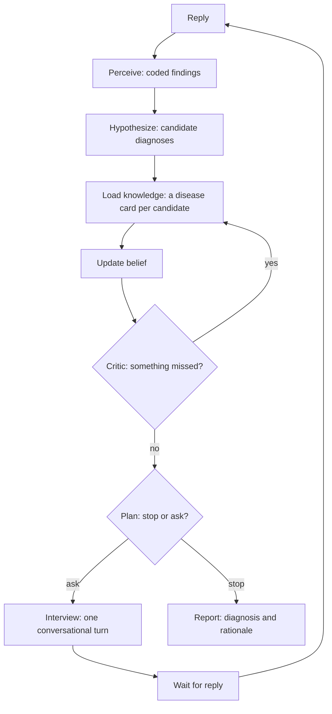

# nova-preciser-dxagent

A diagnostic-interview agent, built in two layers.

1. **A research core** (this branch, `main`): a knowledge-first diagnostic agent. An LLM reads replies and proposes
   diagnoses; a deterministic core updates the probabilities from compiled disease cards, chooses the next question,
   exam or test by value of information, and decides when to stop.
2. **A contest runtime** (the three numbered branches): an interviewing doctor for the N.O.V.A competition, built
   around the research core and developed against the organizers' starter package and development kit. It plays a
   Korean, CPX-style outpatient visit one action per turn and ends with an S/O/A/P note and one diagnosis.

Research prototype; not a medical device, not medical advice. No license is granted with this repository.

## Branches

Each branch builds on the one above it; the commit on each branch is the whole step.

| Branch | Version | What it adds | Official score |
|---|---|---|---|
| `main` | 0.4.2 | The research core: LangGraph agent, Bayesian belief over compiled disease cards, value-of-information planner, simulation studies, an AgentClinic benchmark adapter | none |
| `first-simple-approach` | 0.8.1 | The contest runtime: 58 complaint playbooks lead the interview, 4 model calls per visit, a ledger-based note, the core switched off | 63.131 |
| `second-clean-approach` | 0.9.0-pre | A simulated contest server (65 cases, 36 scenarios), a presubmit gate, CI, and the hardening they found | 66.174 |
| `third-friendly-approach` | 0.9.1 | Friendlier talk, an exam announcement, a spoken follow-up, no repeated questions | 60.737 |

"Official score" is the total (out of 100) of one preliminary-round evaluation. Each is a single run of a few cases; a
difference under about 10 points between runs is noise. `second-clean-approach` is the best of the three.

## How the research core works

The agent reasons the way a clinician does, but writes every step down as numbers.

1. **Listen.** A reply becomes a coded finding ("pain worse on inspiration": present, confidence 0.9).
2. **Suspect.** An LLM proposes candidate diagnoses. A separate call that sees only age, sex, setting and the main
   complaint sets each one's starting probability, so everything else the patient says counts once, as evidence.
3. **Look up knowledge.** Each candidate has a *disease card*: how often each finding and test result occurs in that
   disease, with the source, quote and confidence of every number.
4. **Update.** Probabilities are recomputed from the findings by arithmetic, not by an LLM's opinion.
5. **Double-check.** A critic looks for missed and dangerous diagnoses and can block a premature commit.
6. **Choose the next move.** For every possible question, exam or test the agent estimates how much it would sharpen
   the differential, minus its cost and risk, and takes the best one, or stops.
7. **Ask**, wait for the answer, repeat.



Knowledge is **compiled offline, never drafted during a case**: a language model copies verbatim quotes with their
numbers from cited sources (guidelines, diagnostic-accuracy reviews, curated databases), code verifies each quote and
computes the value, and confidence comes from a fixed table by source tier. Disease identity comes from the MONDO
ontology and findings map to HPO. Details: `docs/CORE.md`.

## Quick start

```bash
python -m venv .venv && source .venv/bin/activate
pip install -e ".[dev]"
cp .env.example .env                    # API keys (DEEPSEEK_API_KEY, OPENAI_API_KEY) for the live commands

pytest -q                               # 102 tests, no API key
dxagent chat --offline                  # plumbing check on demo fixtures, no API key

dxagent kb fetch                        # MONDO, HPO and HPO annotations
dxagent kb compile                      # compile disease cards from sources/manifest.yaml (docs/SOURCES.md)
dxagent chat --show-state               # a real conversation: you are the patient
dxagent download && dxagent bench -n 20 # the AgentClinic benchmark (docs/LIVE_EXPERIMENT.md)
```

## Layout

```
dxagent/   cli, config, prompts, llm, session, priors; graph/ (LangGraph nodes); reasoning/ (belief, planner, harm,
           safety); knowledge/ (cards, ontology, compiler/, registry/); env/ (AgentClinic adapter); bench/ (runner, report)
tests/     102 tests: belief, planner, graph end to end, benchmark, compiler, providers
experiments/  simulation studies of the core, their scripts and paired analyses (README.md)
docs/      CORE.md, LIVE_EXPERIMENT.md, SOURCES.md, decisions/
```

## Documentation

| File | What it holds |
|---|---|
| `docs/CORE.md` | The core's design: loop, knowledge cards, planner, prior context, running it |
| `docs/decisions/` | Decision records: prior context (20-22), the knowledge compiler (29-35) |
| `docs/LIVE_EXPERIMENT.md` | How to run the live benchmark and read its report |
| `docs/SOURCES.md` | Source documents the compiler can use |
| `experiments/README.md` | Simulation studies and their results |
| `CHANGELOG.md` | What changed in each version |

Acknowledgements: AgentClinic (Schmidgall et al., MIT-licensed); the test fixtures hold three of its cases.
