# nova-preciser-dxagent

A diagnostic-interview agent, built in two layers: a **research core** (`main`) and a **contest runtime** around it (the
three `*-approach` branches), developed against the N.O.V.A competition's starter package and development kit. This
branch, `second-clean-approach`, adds a simulated contest and a presubmit gate to the first contest version. Research prototype;
not a medical device, not medical advice. No license is granted with this repository.

## Branches

Each branch builds on the one above it; the commit on each branch is the whole step.

| Branch | Version | What it adds | Official score |
|---|---|---|---|
| `main` | 0.4.2 | The research core: LangGraph agent, Bayesian belief over compiled disease cards, value-of-information planner, simulation studies, an AgentClinic benchmark adapter | none |
| `first-simple-approach` | 0.8.1 | The contest runtime: 58 complaint playbooks lead the interview, 4 model calls per visit, a ledger-based note, the core switched off | 63.131 |
| `second-clean-approach` | 0.9.0-pre | A simulated contest server (65 cases, 36 scenarios), a presubmit gate, CI, and the hardening they found | 66.174 |
| `third-friendly-approach` | 0.9.1 | Friendlier talk, an exam announcement, a spoken follow-up, no repeated questions | 60.737 |

"Official score" is the total (out of 100) of one preliminary-round evaluation. Each is a single run of a few cases; a
difference under about 10 points between runs is noise. `second-clean-approach` is the best of the three.

## What this branch does

`run.py` and `dxagent/nova/` play one Korean, CPX-style outpatient visit per case: the agent asks one question or
requests one exam maneuver per turn (at most 30 characters, 50 turns), explains its findings to the patient, and ends
with an S/O/A/P note and one diagnosis. It follows the contest SDK's contract (`run_agent(prepare, consult)`) and needs
only six pinned wheels.

```mermaid
flowchart LR
    O[Opening and vital signs] --> P[Pick the complaint's playbook]
    P --> H1[History of the complaint]
    H1 --> F[Focus call: trim and extend for this patient]
    F --> H2[Background and review of systems]
    H2 --> T[Time-out call: re-read, ask what would change the ranking, order the exam]
    T --> E[Exam, one maneuver per turn]
    E --> C[Assessment call, then 5 spoken explanations]
    C --> N[Chart call, S/O/A/P note, one diagnosis]
```



- **Playbooks lead.** 58 YAML files, one per chief complaint, give the history questions, maneuvers, differential,
  work-up and plan. They are the deterministic floor: the visit still works when the model returns broken output. They
  are `status: draft` until a clinician signs them off (`docs/PLAYBOOK_REVIEW.md`).
- **Four model calls.** A focus call after the complaint's history (skips or adds items for this patient), a diagnostic
  time-out before the exam, the assessment and plan, and the chart. Positive answers are followed up by the playbook's
  own questions (how much, how long, getting worse).
- **Friendly and explicit.** The doctor greets by name, acknowledges pain and worry, asks what worries the patient, and
  ends with five spoken explanations (cause, tests, treatment, warning signs, the answer to the worry). Gathering ends
  by turn 44 of 50.
- **The note is written from a ledger** of what was asked and answered, in a CPX chart layout; items not confirmed stay
  `( )`; a number the visit never produced is dropped. Deterministic safety checks run on the plan.
- **It never fails a case.** A per-case budget keeps a valid DIAGNOSE and the one required model call, whatever the
  model or the network does. Time is planned from the pace observed in the case (seconds per patient answer and per
  model call), and every blocking SDK call runs under a watchdog, so a slow server shortens the visit instead of
  pushing DIAGNOSE past the deadline.
- **It is tested without the server.** `sim/` plays 65 simulated cases under 36 server, network, model and patient
  scenarios (2,340 visits) against a simulated contest server; `python -m sim.presubmit` is the go/no-go before a ZIP is
  uploaded, and a CI workflow runs it on every push and keeps the ZIP as an artifact (`docs/SUBMISSION.md`).
- The research core (LangGraph, Bayesian belief update, knowledge cards) is still in the package but off by default
  (`docs/CORE.md`).

Offline, on the 65 local practice cases with a scripted patient: history coverage 0.76, key-exam coverage 0.71, 42.2
turns, no refused action (the original 18 cases: 0.84 / 0.83 / 42.5); the kit's three sample cases complete from the
built ZIP in 38-45 turns. These numbers compare versions; they do not predict the score.

Official run, in points (the total is out of 100):

| Branch | Total | Gathering /25 | Reasoning /15 | Tests /10 | Safety /15 | Communication /15 | Efficiency /20 |
|---|---|---|---|---|---|---|---|
| `first-simple-approach` | 63.131 | 14.07 | 11.33 | 6.29 | 15.00 | 5.20 | 11.24 |
| `second-clean-approach` | 66.174 | 14.70 | 13.00 | 6.46 | 15.00 | 5.60 | 11.41 |

## Quick start

```bash
python3.12 -m venv .venv && source .venv/bin/activate
pip install -r requirements.txt pytest                             # the runtime's 6 wheels
python run.py --case dxagent/nova/cases/sample_pe.json --offline   # a full visit through consult(), no model
python -m sim.presubmit                                            # go/no-go in about 2 minutes; builds dist/submission.zip
python -m sim --ids L04,M05 --scenarios oracle,model_slow -v       # chosen cases under chosen scenarios (python -m sim --help)
python -m dxagent.nova.playbooks                                   # validate the 58 playbooks
pip install -r requirements-dev.txt && pytest -q                   # all 350 tests (graph, bench, compiler)
```

`nova_sdk.py` (optional in the ZIP), the sample runner and the guideline library come from the contest's starter package;
they are git-ignored and not included here. Live runs with a development key: `docs/LIVE_RUNS.md`. Never put a key in a
file or a commit.

**Contest material.** The contest runtime was developed against the organizers' starter package and development kit.
None of their files are in this repository, and the documents here do not restate the competition's rules, scoring or
cases; the practice cases, answer keys and playbooks are this project's own.

## Layout

```
run.py              contest entry point: prepare(), consult(client, state); --case, --bench, --stdio for development
dxagent/nova/       the runtime: agent (the visit), playbooks + playbooks/*.yaml, checklist, ledger, soap (the note),
                    prompts, safety, korean, protocol, sdk (client adapter), llm, budget, guidelines, config,
                    env + devclient + offline + judge + bench (development), package (the submission ZIP)
dxagent/            the research core: graph/, reasoning/, knowledge/, env/, bench/, session, priors, llm, cli
tests/              runtime and simulator tests and core tests; 350 in all
experiments/        simulation studies, the 65 local CPX cases (data/nova_cpx) and their checks, live-run report
sim/                the simulated contest: server, clients, actors, Doctor stand-ins, scenarios, presubmit, ZIP check
docs/               guides and decision records
.github/workflows/  presubmit.yml: the gate on every push, the ZIP as an artifact
```

## Documentation

| File | What it holds |
|---|---|
| `docs/AGENT.md` | The runtime guide: the visit, playbooks, the note, time and failure handling, the simulator, configuration |
| `docs/SUBMISSION.md` | Building the ZIP, the presubmit gate, reading a sample validation, settings without code |
| `docs/decisions/v0.5-simple-approach.md` | Decisions 38-104 (the runtime), with the evidence |
| `docs/PLAYBOOK_REVIEW.md` | The AI review log and the doubts for a clinician |
| `docs/LIVE_RUNS.md` | Step-by-step live runs with a development key |
| `docs/CORE.md` | The research core: design, knowledge, planner, benchmark |
| `docs/decisions/v0.3.1-prior-context.md`, `v0.4-knowledge-compiler.md` | Decisions 20-35 (the core) |
| `docs/SOURCES.md`, `docs/sources_manifest.template.yaml` | Source documents for the knowledge compiler |
| `experiments/README.md` | Simulation studies and the local case checks |
| `CHANGELOG.md` | What changed in each version |

The playbook review sheet (`docs/PLAYBOOKS.md`, 400 KB) is generated, not committed:
`python -m dxagent.nova.playbooks --sheet docs/PLAYBOOKS.md`.
