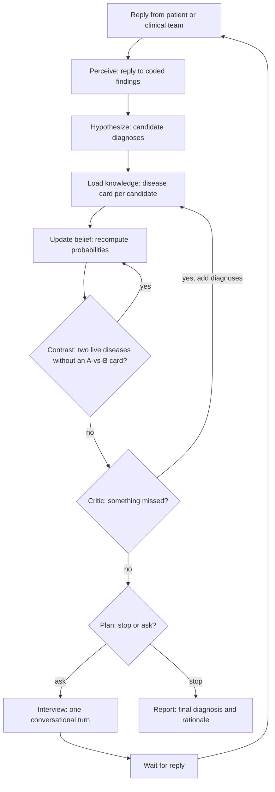

# The research core: a knowledge-first diagnostic agent

A multi-turn diagnostic agent on LangGraph and LangChain. In each encounter it chooses its next question, exam or test,
re-plans after every reply and commits to a diagnosis when more information is no longer worth its cost. Research
prototype; not a medical device, not medical advice.

- **LLMs handle language:** replies to coded findings, candidate diagnoses, question phrasing, and (offline) copying
  verbatim quotes from cited sources.
- **A deterministic core handles inference and decisions:** knowledge is stored per disease as frequencies; ratios are
  formed at run time between the diseases on the differential; the planner picks the action that best separates the
  diseases still confusable, and stops by explicit rules. The same findings always give the same differential.

## Loop



| Node | Kind | Role |
|---|---|---|
| `perceive` | LLM | reply to coded findings (present/absent, confidence, verbatim evidence); numeric labs and vital signs mapped by registry thresholds |
| `hypothesize` | LLM | 6-10 candidates, resolved to ontology ids by rule; their pretest buckets come from the prior assessor |
| `load_knowledge` | deterministic (+ prior LLM) | pretest bucket from S alone; checks each top candidate has a card (own or inherited) and logs misses |
| `update_belief` | deterministic | frequencies against backgrounds, categorical test outcomes, correlation clusters, confidence shrinkage, residual "other" mass; **reverse index**: known diseases the LLM did not propose join when the evidence makes them at least 5% likely |
| `contrast` | LLM (cached) | for live pairs without a card, elicit "A vs B" findings and tests over existing codes |
| `critic` | rules + LLM | before a commit and periodically: adds missed diagnoses, can veto a commit (a veto must name an alternative and is resolved by the arithmetic) |
| `plan` | deterministic | intake script, then turn-level value of information; stop rules |
| `interview` | LLM | planned action(s) to one conversational turn |
| `await_reply` | interrupt | pauses the graph; resumed by the chat user or the simulator |
| `report` | LLM | final diagnosis and rationale; the diagnosis is the top of the computed differential, and a dissent is an objection resolved by the arithmetic |

## Knowledge

Clinicians learn diseases as illness scripts and differentiate by comparing them; the knowledge layer does the same.

- **Disease card:** per disease, `P(finding | disease)` and `P(test outcome | disease)`, each entry with provenance
  (source, tier, edition, locator, quote) and a confidence.
- **Registries:** what belongs to a finding or test rather than a disease: the finding's background rate; a test's
  outcomes, background distribution, cost, risk and numeric thresholds (D-dimer > 500 ng/mL is `elevated`). Tests are
  categorical, so one chest film can separate five diseases at once.
- **Contrast card (A vs B):** comparatively elicited frequencies for two confusable live diseases (each at least 10%).
  The one LLM-only knowledge path left: existing codes only, confidence capped at 0.55, never admits a disease through
  the reverse index.
- **No likelihood ratio is stored.** The odds of A against B change by `P(obs | A) / P(obs | B)`, formed at run time.
  A published LR compares a disease with an unspecified "everyone else" in some study population.
- **Confidence** shrinks weak entries toward the background: `p_eff = conf * p + (1 - conf) * background`.

### Where cards come from (v0.4)

Compiled offline from a source manifest; nothing is drafted during a case.

| Layer | Contents | Where |
|---|---|---|
| Ontology | MONDO diseases (CC BY 4.0), HPO phenotypes, local extension terms for entities MONDO lacks | `dxagent kb fetch` to `kb/ontology/`; `dxagent/knowledge/registry/local_terms.yaml` |
| Registry | curated finding and test definitions, thresholds, complaints | `dxagent/knowledge/registry/` |
| Sources | manifest of every source: kind, tier, edition, licence, file, diseases | `sources/manifest.yaml` (git-ignored with the files; template: `docs/sources_manifest.template.yaml`; what to download: `docs/SOURCES.md`) |
| Compiled cards | one card per disease | `kb/cards.jsonl.gz`, `kb/findings.jsonl`, `kb/build.json`, `kb/compile_report.json` |
| Run-time cache | contrast cards, on-demand cards, provisional online cards | `cache/` |

**Tiers.** 1: guidelines, systematic and diagnostic-accuracy reviews (including JAMA Rational Clinical Examination).
2: curated databases (HPO and Orphanet annotations) and reference texts. 3: primary studies and abstracts.

**How a value enters a card.**

1. The extractor LLM reads selected passages of one source for one disease and copies verbatim quotes with their
   numbers. Output is cached by the file's SHA-256, so recompiling is deterministic.
2. Code verifies each claim: the quote occurs verbatim; every number appears in it; it names the finding or test (and
   the disease, for multi-disease sources).
3. Code computes the value (percent, n of m shrunk, sensitivity with 1 - specificity as background, an LR pair, an
   HPO frequency class, or one frequency word).
4. Reconciliation per disease and finding: higher tier, then numeric over class over qualitative, population match,
   newer edition, larger sample. Disagreeing sources are recorded, never averaged.
5. Confidence = table[tier][precision] x population directness (1.0, 0.9, 0.8). No LLM judges trust.

HPO annotations give `P(phenotype | disease)` for about 9,400 rare diseases without any LLM. A disease without a card
inherits its nearest carded ancestor (3 levels, x0.9 each). Backgrounds of new codes: 1 - specificity when stated, else
a prevalence-weighted card mixture (rare-disease cards at most 5% of the weight, clamped to [0.02, 0.5]); curated
registry values are never overwritten. Fallbacks for a disease with no card: the documents in `sources/` (on demand,
same pipeline, on by default), then PubMed abstracts (`DX_LIVE_FALLBACK=1`, provisional cards, confidence at most 0.5).
**Leakage rule:** never compile from the benchmark's own diagnosis list.

## Choosing the next move

For each candidate question, exam or test the agent simulates every answer, recomputes the differential and scores

```
value = 10 x (expected drop in P(leader wrong))  +  2 x (expected drop in C)  -  cost/1000  -  procedural risk
C = sum over pairs i<j of w_ij * sqrt(b_i * b_j)        (Bhattacharyya confusion of the live pairs)
```

so it asks "A or B?" about pairs that are actually live, and information never scores negative. Up to three questions,
exams or cheap tests share a turn; imaging and procedures go alone, CT-level imaging only once a disease it would
confirm reaches 5% and invasive procedures 25%.

**Harm** enters per confusion: `L(i -> j) = miss(j) x urgency(j) x (1 - treatment_overlap(i, j)) + overtreatment_harm(i)`.
The default **accuracy** objective weights every pair 1 (the benchmark scores the exact diagnosis); the **clinical**
objective uses `w_ij = 1 + (L(i->j) + L(j->i)) / 2`, and can't-miss alternatives must also fall below 3% before a commit.

**Stop rules.** The leader reaches 80% (unless the critic objects); or nothing is worth doing and the leader has at
least 40%; or nothing was worth doing for 3 turns; or the 60-turn cap (a ceiling; `DX_MAX_TURNS=20` for published
AgentClinic comparisons).

## Prior context (v0.3.1)

The pretest probability may depend only on S = {age, sex, care setting, primary complaint}; everything else the patient
says is evidence, counted once through the cards (decisions 20-22: `docs/decisions/v0.3.1-prior-context.md`). An
information-hidden assessor (one LLM call that sees only S and the disease names, median of 3) sets every bucket; the
primary complaint is chosen by rule (stated reason for the visit, then triage acuity, then earliest mention); cards
carry prevalence per complaint. Vital signs become findings by registry thresholds (heart rate > 100, temperature
> 38 degrees C, respiratory rate > 22, systolic pressure < 90, SpO2 < 92%). `DX_PRIOR_CONTEXT=0` restores v0.3.0;
`DX_PRIOR_SAMPLES=1` cuts the extra cost from about 5.5 to 1.9 calls per case.

## Running it

```bash
pip install -e ".[graph,dev]"                    # or: pip install -r requirements-dev.txt
cp .env.example .env                             # API keys and model profile
pytest -q                                        # offline, no API key
dxagent chat --offline                           # plumbing check on the demo fixtures
dxagent chat --show-state                        # a real conversation: you are the patient
dxagent download                                 # AgentClinic MedQA datasets
dxagent bench -n 20 --verbose                    # the agent on 20 cases (--agent baseline: single-LLM baseline)
dxagent bench -n 50 --perturb 2                  # robustness: every frequency's odds scaled up to x/÷2
dxagent bench -n 50 --objective clinical         # harm-weighted confusions
dxagent kb fetch | sources --check | compile [--no-llm] | coverage <list> | stats | show
dxagent bench-report runs/A runs/B --out dxagent_live_summary.json
```

`python -m dxagent ...` works the same as `dxagent ...`. Chat commands: `/state` (differential, entropy, turn, cost),
`/findings`, `/quit`; each chat is saved to `runs/chat_<timestamp>.json`.

**Benchmark.** AgentClinic gives the doctor only the case objective. The adapter (`dxagent/env/agentclinic.py`) routes
history questions to a patient LLM (lay language, only what is asked) and exams and tests to a records LLM that reads
the case's fixed tables (unlisted items return "normal"). Run the patient on a different model family from the doctor
(`DX_PATIENT_MODEL`); same-family pairs inflate scores. Each run writes `runs/<timestamp>_<agent>_<dataset>/` with
`results.jsonl`, `summary.json` (top-1 and top-3, turns, test cost, Brier, calibration, leak flags, prior diagnostics),
`report.json` and `run_meta.json`. `dxagent bench-report` bundles runs into one analysis file with paired comparisons
(McNemar, bootstrap CIs) and per-module diagnostics.

**Models (v0.4.2 profile).** DeepSeek runs the agent (`DX_DOCTOR_MODEL`, `DX_CARD_MODEL`, `DX_PRIOR_MODEL`) and OpenAI
the simulated environment and judge (`DX_PATIENT_MODEL`, `DX_MEASUREMENT_MODEL`, `DX_JUDGE_MODEL`); specs such as
`deepseek:deepseek-v4-pro?thinking=low` or `openai:gpt-5-mini?effort=minimal` (`dxagent/llm.py`); an Anthropic profile is in
`.env.example`. Costs are estimated from list prices (`dxagent/bench/prices.py`).

**Ablation arms** (each with its own `DX_CACHE_DIR`; paired by case; MedQA has 107 cases, so one run's top-1 has a
95% CI of about +/- 9 pp): as shipped; `--agent baseline` (the bar); `DX_LOCAL_FALLBACK=0`; `DX_LIVE_FALLBACK=1`;
`DX_COMMIT_THRESHOLD=0.90`; `--objective clinical`; `DX_CRITIC=0`; `DX_REVERSE_INDEX=0`; `DX_CONTRAST=0`;
`--perturb 2`.

## Design choices and what simulation showed

Numbers are held-out, paired, simulation-only results (`experiments/README.md`); absolute values do not transfer to real
cases.

- **Frequencies, not likelihood ratios (v0.2).** LRs from different studies do not combine across a differential and
  rarely exist for rare diseases. Cards store `P(finding | disease)`; ratios are formed between the live diseases at run
  time. Top-1 +0.8 to +2.0 pp and 26-28% less test cost than stored LRs.
- **Reverse index (v0.2.1).** A disease never proposed can never be diagnosed, so after every update each known disease
  absent from the differential is re-scored and joins at 5%. Top-1 +24 / +15 / +4 pp at LLM recall 0.6 / 0.75 / 0.9.
- **Planner.** Harm stays out of the decision loss (it made "commit to the most dangerous disease" look safe) and enters
  through the pairwise confusion weights, the can't-miss rule and the critic. The uncertainty term is the pairwise
  Bhattacharyya confusion; an entropy term was not a Bayesian entropy and was replaced. Expensive tests wait for
  prerequisites; a stall rule ends a case that drifts.
- **v0.3 fixes (together: top-1 0.887 to 0.930, Brier -0.047, ECE -0.026).** Only the primary complaint conditions the
  prior; a deterministic lexicon and canonical finding codes; card prevalence for the reverse index; a critic's veto must
  name an alternative and is settled by the arithmetic; the report LLM's dissent is an objection, not the answer.
- **v0.3.1.** The prior conditions on S only, by construction. Neutral in simulation, adopted for the structural
  guarantee (the prior cannot leak the generator's knowledge).
- **v0.4.** LLM-only card drafting removed: cards are compiled from cited sources, identity comes from MONDO and HPO.
  Performance is set by coverage and by the share of entries a source states.
- **Tested and left off (one flag each):** background-rate pass, evidence-ratio reverse-index admission, discovery
  prompts, open-world re-prompt, conditional batch valuation.

## Status and limitations

- **No live-LLM numbers for the core.** It is tested offline (including an end-to-end compile with verified and rejected
  claims) and in simulation (`experiments/README.md`).
- **Coverage depends on the sources you add.** `kb fetch` plus `kb compile` with no documents gives about 9,400
  rare-disease cards and nothing for common diseases; `kb coverage` reports the gap.
- **Guidelines are not likelihood tables.** Frequencies come mostly from diagnostic-accuracy reviews and reference
  texts; entries no source states stay empty (the background is used), which is intended.
- **Licences.** Keep subscription material (JAMA RCE, UpToDate) in `sources/` (git-ignored); entries keep quotes of at
  most 30 words.
- **Approximations.** HPO-only backgrounds are rare-disease averages; HPO does not say how a phenotype is observed,
  so the compiler guesses the channel from the label; contrast cards remain LLM-elicited; planning looks one turn
  ahead; "other" grows with pertinent negatives, which lowers top-1 confidence.

Acknowledgements: AgentClinic (Schmidgall et al., github.com/SamuelSchmidgall/AgentClinic, MIT); the test fixture
holds three of its cases.
